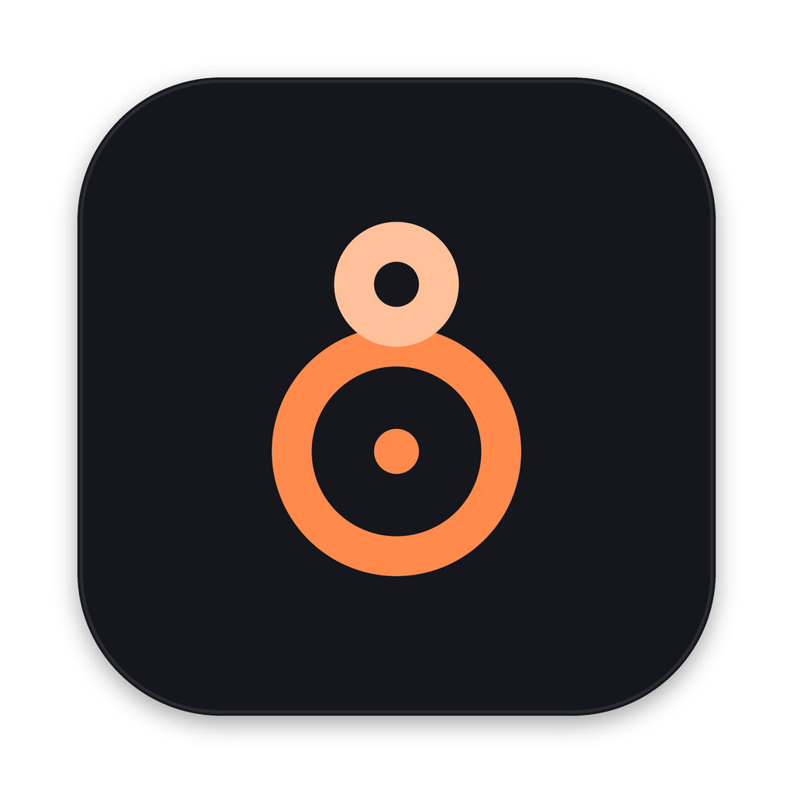

# Octava

Reproductor de música para Mac que administra una colección local de MP3: discos completos, mezclas aleatorias,
edición de tags y scrobbling a Last.fm.



## Estado

Fase 0 (esqueleto): elegir la carpeta de música, escanearla, ver la grilla de álbumes con carátulas, abrir un disco,
reproducirlo, marcar favoritos y llevar la cuenta de reproducciones. Ver el plan completo en `docs/SPEC.md`.

## Primeros pasos en el Mac

1. Instala **Xcode** desde la App Store y ábrelo una vez para aceptar la licencia.
2. Instala **Homebrew** si no lo tienes: https://brew.sh
3. En la Terminal, dentro de esta carpeta:

   ```bash
   ./bootstrap.sh
   open Octava.xcodeproj
   ```

   `bootstrap.sh` instala XcodeGen, genera el proyecto de Xcode e inicia el repositorio git.
4. En Xcode, presiona ⌘R. La primera vez, Octava te pedirá la carpeta de tu colección de MP3.

## Seguir con Claude Code

Abre Claude Code en esta carpeta (app de escritorio de Claude o `claude` en la terminal). Al iniciar lee `CLAUDE.md`,
que resume el proyecto, los comandos, las convenciones y el estado de cada fase. Puedes empezar con:

> Ejecuta bootstrap.sh, compila el proyecto y corrige lo que falle. Después dime qué debo probar en Xcode.

Y luego, fase por fase:

> Lee docs/SPEC.md y docs/DESIGN.md e implementa la fase 1.

## Subir a GitHub

Crea un repositorio privado vacío en GitHub y, desde esta carpeta:

```bash
git remote add origin https://github.com/<tu-usuario>/octava.git
git push -u origin main
```

## Estructura

| Carpeta | Contenido |
| --- | --- |
| `Octava/` | Código de la app (SwiftUI) y recursos |
| `OctavaTests/` | Tests |
| `docs/SPEC.md` | Especificación y fases |
| `docs/DESIGN.md` | Diseño: colores, tipografía, pantallas, ícono |
| `docs/mockups/` | Referencias de diseño de cada pantalla |
| `docs/brand/` | Ícono en SVG y PNG, y el script que genera los tamaños |
| `project.yml` | Definición del proyecto de Xcode (XcodeGen) |
